# Schema startup repair - 28 October 2026

The database configured by the ignored backend `.env` has been upgraded explicitly to schema version `2026102708`. `cargo run --locked --bin ecg-backend` passed the local HTTP startup check against that database. Normal startup still uses `APPLY_MIGRATIONS=false`; schema checks and authentication remain enabled.

```mermaid
flowchart LR
    Snapshot[Consistent public snapshot] --> Backup[Protected DB and local file backups]
    Backup --> Restore[Isolated loopback restore]
    Restore --> Stage[Run versioned migrations]
    Stage --> Verify[Compare original rows and history]
    Verify --> Preflight[Recheck configured DB and inactive acquisition]
    Preflight --> Upgrade[Explicit configured DB migration]
    Upgrade --> Preserve[Verify original rows and credential move]
    Preserve --> Smoke[Local health 200 / ready 200 / anonymous 401]
```



## Migration history

The configured database already contained SQLx versions 1-3 from the original application. Reusing these version numbers for the audit migrations caused a history/checksum collision. The eight current migrations now use versions `2026102701`-`2026102708`.

`src/db/legacy_migrations.json` pins the three observed original versions, descriptions and SHA-384 checksums. Their original SQL is absent from the available repository history. Only these exact successful historical entries may be missing from the current migration source. Unknown history fails before running DDL; SQLx continues to check all current migration checksums. The existing ledger was preserved, including its timestamps and execution metadata; eight entries were appended.

## Backup and preservation

A restricted-access, Git-ignored backup is retained under `backups/startup-upgrade/20261028_115329_refresh/`. It contains a consistent PostgreSQL custom archive of the public schema/data, archive inventory, SHA-256 metadata, local records/uploads ZIPs and private preflight/verification logs. Auth schema and Auth users were not modified or backed up by this operation. The file ZIPs cover this workspace's files; they do not prove that every remote recording exists locally.

The archive was restored into an isolated loopback PostgreSQL staging database and migrated successfully before the configured database was upgraded. Preflight was repeated immediately before applying migrations, with no unended sessions. The first backup was refreshed because a new session and 14 frames had arrived before cutover.

Post-upgrade checks matched row counts and fingerprints of every original business column except the intentionally transformed account identity and credential columns. All original migration ledger columns also matched.

| Preserved data | Rows |
|---|---:|
| Accounts | 164 |
| Patient profiles | 165 |
| Doctor profiles | 9 |
| Devices | 3 |
| Sessions | 204 |
| Frames | 2,832 |
| Original migration entries | 3 |
| MQTT credential configurations moved to private storage | 2 |

Legacy password hashes and device credential columns were removed by the approved security migration; the protected archive retains their pre-upgrade values. Credential values matched after moving into `device_credentials`. Restoring this archive is a coordinated database/file rollback and is incompatible with the new binary until the matching version is restored. Never re-enable an old binary against the upgraded schema.

## Ambiguous legacy identities

Eleven account groups already had multiple patient profiles with conflicting demographics. Those profiles and their separate session histories were retained without merging, selecting a preferred patient or moving records. A database trigger prevents new duplicate assignments while allowing updates to existing profiles without changing their account. Account provisioning serializes by Auth subject and rejects ambiguous profile reuse.

Login and administrator impersonation require exactly one profile for a patient/doctor account. Ambiguous accounts receive HTTP 409 requiring administrator review. An administrator must verify the real identity and consent before any later account/profile reassignment.

The existing mapping `auth_id = account.id` was backfilled as specified by the migration. Preflight found 63 account IDs matching Auth subjects and 101 accounts without an Auth subject match. Those 101 require verified account recovery/mapping; no email-based guesses or Auth accounts were created. Startup success does not establish that every legacy account can log in.

## Verified startup and remaining operations

The actual local `cargo run` used the configured upgraded database with loopback binding and MQTT connections explicitly disabled for the smoke test. `/api/health` and `/api/ready` returned 200; `/api/auth/me` without credentials returned 401. The smoke process was then stopped. Normal operation can now start with:

```powershell
cargo build
cargo run
```

MQTT listeners still require explicitly reviewed `MQTT_ALLOWED_BROKERS`, TLS port 8883 and compatible firmware. No broker connectivity, live acquisition, remote deployment, service restart, Auth email delivery, dedicated runtime-role rollout or credential rotation is established by this smoke test. Continue the outstanding deployment checks in [rollout.md](rollout.md).

For a different database, back it up and inspect identity/schema/history conflicts before running the operator command `cargo run --bin ecg-backend -- --migrate-only`. Do not rerun the original schema initializer, clear the migration ledger or disable readiness to bypass errors.
